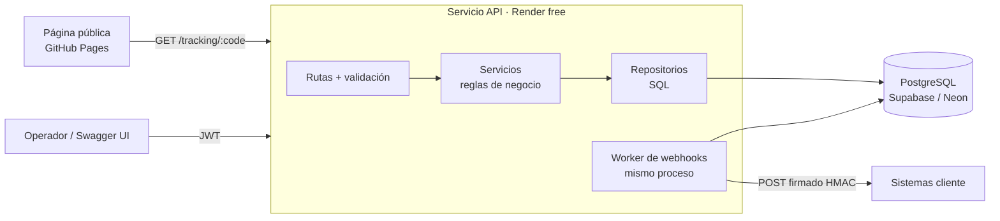
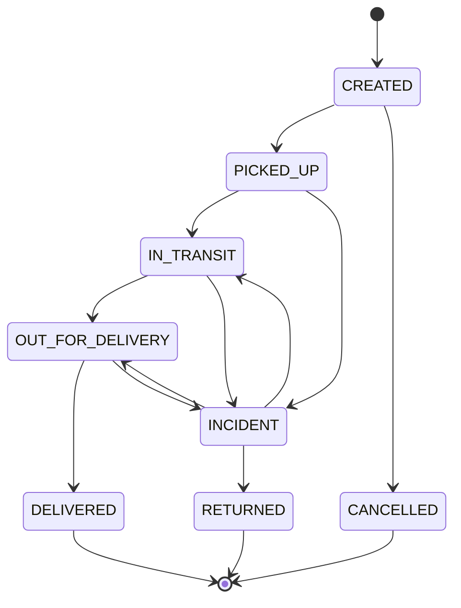
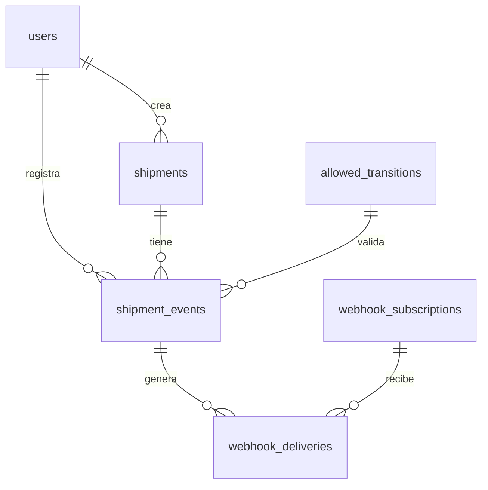

# LogiTrack · API de seguimiento de envíos — Diseño

Versión 0.1 · borrador de arquitectura y modelo de datos

## 1. Alcance

**Dentro**
- Operadores autenticados crean envíos y registran eventos de estado.
- Cualquiera consulta el estado público de un envío con su código de seguimiento.
- Administradores registran URLs de webhook que reciben los cambios de estado.

**Fuera (por ahora)**
- Cálculo de tarifas (proyecto 2), inventario (proyecto 3), rutas (proyecto 4).
- Multiempresa, pagos, notificaciones por email.

## 2. Arquitectura

Monolito modular en capas. Un solo servicio para no salir del plan gratuito.



**Capas**
- **Rutas:** HTTP, validación de entrada, códigos de respuesta. Sin lógica de negocio.
- **Servicios:** máquina de estados, transacciones, reglas.
- **Repositorios:** único sitio donde hay SQL.
- **Worker:** bucle dentro del mismo proceso que entrega webhooks pendientes.

## 3. Decisiones de arquitectura

| # | Decisión | Por qué | Alternativa descartada |
|---|----------|---------|------------------------|
| D1 | Historial de eventos *append-only* + estado actual cacheado en `shipments.status` | Auditoría completa y lecturas rápidas | Solo guardar el estado actual (se pierde historia) |
| D2 | Transiciones válidas en una tabla `allowed_transitions` con FK compuesta | La BD rechaza transiciones inválidas aunque el código tenga un bug | Validar solo en código |
| D3 | Patrón *outbox* para webhooks: se escriben en `webhook_deliveries` en la misma transacción que el evento | Ningún webhook se pierde y no hace falta una cola de pago | Enviar el webhook en la petición HTTP (si falla, se pierde) |
| D4 | Worker en el mismo proceso | El plan gratuito da un servicio; un worker aparte costaría dinero | Servicio de worker separado |
| D5 | Endpoint público con datos mínimos | Privacidad: no expone dirección ni email del destinatario | Devolver el envío completo |
| D6 | `SELECT ... FOR UPDATE` sobre el envío al registrar un evento | Dos eventos simultáneos no pueden dejar un estado incoherente | Sin bloqueo |

## 4. Máquina de estados



## 5. Modelo de datos



### DDL (PostgreSQL)

```sql
CREATE TYPE user_role       AS ENUM ('ADMIN', 'OPERATOR');
CREATE TYPE shipment_status AS ENUM (
  'CREATED', 'PICKED_UP', 'IN_TRANSIT', 'OUT_FOR_DELIVERY',
  'DELIVERED', 'INCIDENT', 'RETURNED', 'CANCELLED'
);
CREATE TYPE delivery_status AS ENUM ('PENDING', 'SENT', 'FAILED');

CREATE TABLE users (
  id            UUID PRIMARY KEY DEFAULT gen_random_uuid(),
  email         VARCHAR(255) NOT NULL UNIQUE,
  password_hash VARCHAR(255) NOT NULL,
  role          user_role    NOT NULL DEFAULT 'OPERATOR',
  created_at    TIMESTAMPTZ  NOT NULL DEFAULT now()
);

CREATE TABLE allowed_transitions (
  from_status shipment_status NOT NULL,
  to_status   shipment_status NOT NULL,
  PRIMARY KEY (from_status, to_status)
);

INSERT INTO allowed_transitions VALUES
  ('CREATED','PICKED_UP'), ('CREATED','CANCELLED'),
  ('PICKED_UP','IN_TRANSIT'), ('PICKED_UP','INCIDENT'),
  ('IN_TRANSIT','OUT_FOR_DELIVERY'), ('IN_TRANSIT','INCIDENT'),
  ('OUT_FOR_DELIVERY','DELIVERED'), ('OUT_FOR_DELIVERY','INCIDENT'),
  ('INCIDENT','IN_TRANSIT'), ('INCIDENT','OUT_FOR_DELIVERY'), ('INCIDENT','RETURNED');

CREATE TABLE shipments (
  id                UUID PRIMARY KEY DEFAULT gen_random_uuid(),
  tracking_code     VARCHAR(20)     NOT NULL UNIQUE,      -- p. ej. LT-7K2M9QXA
  status            shipment_status NOT NULL DEFAULT 'CREATED',
  sender_name       VARCHAR(120)    NOT NULL,
  sender_address    TEXT            NOT NULL,
  recipient_name    VARCHAR(120)    NOT NULL,
  recipient_address TEXT            NOT NULL,
  recipient_email   VARCHAR(255),
  origin_city       VARCHAR(80)     NOT NULL,
  destination_city  VARCHAR(80)     NOT NULL,
  weight_kg         NUMERIC(8,3)    NOT NULL CHECK (weight_kg > 0),
  created_by        UUID            NOT NULL REFERENCES users(id),
  created_at        TIMESTAMPTZ     NOT NULL DEFAULT now(),
  updated_at        TIMESTAMPTZ     NOT NULL DEFAULT now(),
  delivered_at      TIMESTAMPTZ
);

CREATE TABLE shipment_events (
  id          BIGSERIAL PRIMARY KEY,
  shipment_id UUID            NOT NULL REFERENCES shipments(id),
  from_status shipment_status,                 -- NULL solo en el evento inicial
  to_status   shipment_status NOT NULL,
  location    VARCHAR(120),
  note        TEXT,
  occurred_at TIMESTAMPTZ     NOT NULL,        -- cuándo pasó en el mundo real
  recorded_by UUID            NOT NULL REFERENCES users(id),
  created_at  TIMESTAMPTZ     NOT NULL DEFAULT now(),  -- cuándo se registró
  -- D2: con from_status NULL la FK no se comprueba (evento inicial)
  FOREIGN KEY (from_status, to_status)
    REFERENCES allowed_transitions (from_status, to_status),
  CHECK (from_status IS NOT NULL OR to_status = 'CREATED')
);

CREATE TABLE webhook_subscriptions (
  id          UUID PRIMARY KEY DEFAULT gen_random_uuid(),
  url         TEXT              NOT NULL,
  secret      VARCHAR(64)       NOT NULL,     -- para firmar con HMAC-SHA256
  event_types shipment_status[] NOT NULL,     -- a qué estados se suscribe
  active      BOOLEAN           NOT NULL DEFAULT true,
  created_at  TIMESTAMPTZ       NOT NULL DEFAULT now()
);

CREATE TABLE webhook_deliveries (
  id              BIGSERIAL PRIMARY KEY,
  subscription_id UUID            NOT NULL REFERENCES webhook_subscriptions(id),
  event_id        BIGINT          NOT NULL REFERENCES shipment_events(id),
  payload         JSONB           NOT NULL,
  status          delivery_status NOT NULL DEFAULT 'PENDING',
  attempts        SMALLINT        NOT NULL DEFAULT 0,
  next_attempt_at TIMESTAMPTZ     NOT NULL DEFAULT now(),
  last_error      TEXT,
  created_at      TIMESTAMPTZ     NOT NULL DEFAULT now(),
  UNIQUE (subscription_id, event_id)          -- nunca duplicar una entrega
);

-- Índices
CREATE INDEX idx_shipments_status_created ON shipments (status, created_at DESC);
CREATE INDEX idx_events_shipment_time     ON shipment_events (shipment_id, occurred_at);
CREATE INDEX idx_deliveries_pending       ON webhook_deliveries (next_attempt_at)
  WHERE status = 'PENDING';
```

## 6. Flujo crítico: registrar un evento

Todo dentro de **una transacción**:

1. `SELECT status FROM shipments WHERE id = $1 FOR UPDATE` — bloquea el envío (D6).
2. Si no existe → `404`.
3. `INSERT INTO shipment_events (from_status = estado actual, to_status = nuevo, ...)`.
   Si la transición no está permitida, la FK falla → el servicio lo traduce a `409 Conflict`.
4. `UPDATE shipments SET status = nuevo, updated_at = now()` (+ `delivered_at` si es `DELIVERED`).
5. `INSERT INTO webhook_deliveries` una fila por cada suscripción activa interesada en ese estado (D3).
6. `COMMIT`.

**Worker de webhooks** (cada ~5 s):
1. `SELECT ... FROM webhook_deliveries WHERE status = 'PENDING' AND next_attempt_at <= now() ORDER BY next_attempt_at LIMIT 10 FOR UPDATE SKIP LOCKED`.
2. `POST` a la URL con cabecera `X-LogiTrack-Signature` (HMAC-SHA256 del cuerpo con `secret`).
3. Respuesta 2xx → `SENT`. Error → `attempts + 1`, `next_attempt_at = now() + 2^attempts minutos`. Tras 5 intentos → `FAILED`.

## 7. API

| Método | Ruta | Acceso | Descripción |
|--------|------|--------|-------------|
| POST | `/auth/login` | Público | Devuelve JWT |
| POST | `/shipments` | OPERATOR | Crea envío + evento inicial `CREATED` |
| GET | `/shipments?status=&page=&size=` | OPERATOR | Lista paginada |
| GET | `/shipments/:id` | OPERATOR | Detalle + historial |
| POST | `/shipments/:id/events` | OPERATOR | Registra cambio de estado |
| GET | `/tracking/:trackingCode` | Público, rate limit | Estado y ciudades, sin datos personales (D5) |
| GET/POST/DELETE | `/webhooks` | ADMIN | Gestiona suscripciones |
| GET | `/health` | Público | Comprobación de vida |

**Códigos de error:** `400` validación · `401` sin token · `403` sin rol · `404` no existe · `409` transición inválida · `429` demasiadas peticiones.

**Formato de error común:**

```json
{ "error": { "code": "INVALID_TRANSITION", "message": "No se puede pasar de DELIVERED a IN_TRANSIT" } }
```

## 8. Decisiones de implementación

| # | Decisión | Por qué |
|---|----------|---------|
| D7 | Java 21 + Spring Boot 4.1 | Es el stack del trabajo diario; refuerza lo que ya se usa |
| D8 | Spring JDBC (`JdbcClient`) con SQL explícito, sin JPA | Control total de `FOR UPDATE`, `SKIP LOCKED` y enums de PostgreSQL; el SQL queda visible para revisarlo |
| D9 | Flyway para migraciones | Estándar en Spring, versiona el esquema junto al código |
| D10 | Paquetes por funcionalidad (`shipment`, `tracking`, `webhook`, `auth`, `shared`) | Cada módulo agrupa su controlador, servicio y repositorio |

**Pendiente:** Supabase o Neon (se decide al desplegar; el código no cambia).
